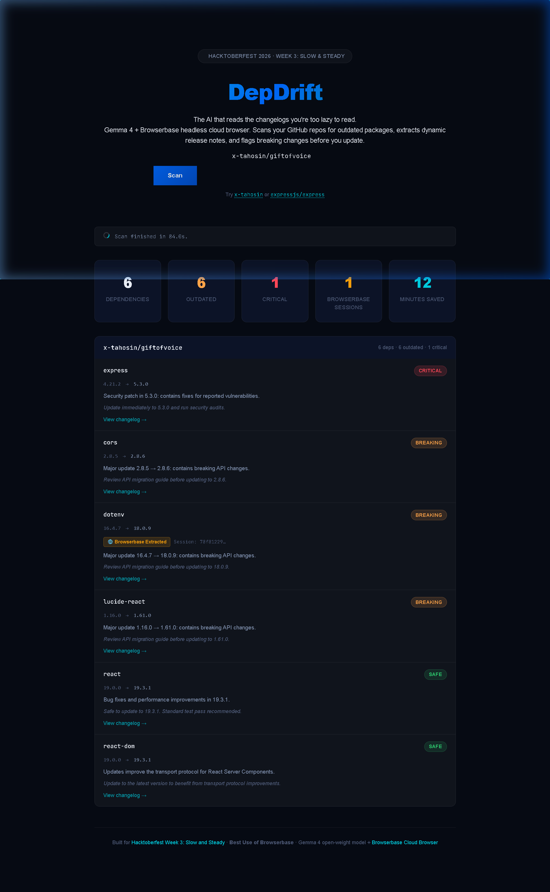

# DepDrift 🔄

**The AI that reads the changelogs you're too lazy to read.**

DepDrift scans your GitHub repositories for outdated dependencies, uses **[Browserbase](https://www.browserbase.com)** headless cloud browsers to extract release notes from dynamic documentation pages, and runs **[Gemma 4](https://ai.google.dev/gemma)** (open weights) to classify every update by risk: what's critical, what's breaking, and what's safe to update.

Built for the **[Hacktoberfest Open-Source AI Challenge: Week 3 — Slow and Steady](https://dev.to/challenges/hacktoberfest-week3-2026-10-19)**.

Target Partner Category: **Best Use of Browserbase**.

---



---

## The Problem

Every developer has outdated dependencies they keep ignoring. Dependabot opens 20 PRs, but nobody reads 20 changelogs. Half the packages bury their release notes across custom documentation sites, npm readmes, or JavaScript SPAs where raw markdown APIs don't exist.

**The Lazy Payoff:** Instead of manually digging through 20 changelogs (40+ minutes of manual context switching), DepDrift scans everything in under 90 seconds and gives you a single dashboard with actionable advice:
- 🔴 **CRITICAL**: Security vulnerability patch (CVE) — update immediately.
- 🟡 **BREAKING**: Renamed exports or removed APIs — read the migration guide first.
- 🟢 **SAFE**: Bug fixes and performance gains — safe to update with standard tests.
- ⚪ **SKIP**: Documentation and typo fixes — safe to batch or ignore.

---

## Architecture

```
User (Browser)
      │
      ▼
FastAPI Backend (SSE Stream)
      │
      ├── GitHub REST API ────► Discovers repositories & dependency manifests
      ├── npm / PyPI Registry ─► Checks latest published versions
      │
      ├── Browserbase (Cloud Browser)
      │     └── Remote Chromium over CDP renders dynamic docs / release pages
      │         and extracts clean changelog text when raw APIs are missing
      │
      └── Gemma 4 (Open Weights)
            └── Analyzes changelog diffs with strict schema:
                { summary, risk: "CRITICAL"|"BREAKING"|"SAFE"|"SKIP", action }
```

---

## Why Browserbase?

Static changelog scraping breaks on modern developer websites. Many libraries (such as Next.js, Vite, Tailwind, and component libraries) host their changelogs on client-rendered documentation sites (VitePress, Docusaurus, Next.js). Traditional HTTP scrapers get an empty `<div id="app"></div>`.

DepDrift integrates **Browserbase**'s cloud headless browser infrastructure:
1. Spawns an isolated cloud browser session via the Browserbase REST API.
2. Connects Playwright over Chrome DevTools Protocol (`connect_over_cdp`).
3. Waits for DOM hydration and renders the changelog text in an isolated, secure environment.
4. Passes the rendered text to Gemma 4, stamping each card with the Browserbase Session ID for full auditability.

---

## Stack

| Component | Technology | Role |
|-----------|-----------|------|
| **AI Model** | **Gemma 4** (`gemma-4-26b-a4b-it`) | Open-weight model for changelog reasoning and risk triage |
| **Cloud Browser** | **Browserbase** | Headless Chrome infrastructure for dynamic changelog extraction |
| **Backend** | **Python 3.11+ / FastAPI** | Async pipeline, registry lookups, and Server-Sent Events (SSE) |
| **Frontend** | **Vanilla HTML / CSS / JS** | Real-time particle background, live logs, glassmorphism cards |
| **Data Sources** | **GitHub API + npm + PyPI** | Authoritative repository and package metadata |

---

## Quick Start

### 1. Prerequisites
- Python 3.11+
- [Browserbase API Key](https://www.browserbase.com)
- Google AI Studio API Key (or local Ollama instance with Gemma)

### 2. Installation
```bash
git clone https://github.com/x-tahosin/depdrift.git
cd depdrift
pip install -r requirements.txt
playwright install chromium
```

### 3. Configure Environment
Copy `.env.example` to `.env`:
```env
PORT=8000
GITHUB_TOKEN=your_github_token_optional
BROWSERBASE_API_KEY=your_browserbase_api_key
BROWSERBASE_PROJECT_ID=your_browserbase_project_id
GEMMA_API_KEY=your_gemini_or_gemma_api_key
GEMMA_MODEL=gemma-4-26b-a4b-it
```

### 4. Run Locally
```bash
python -m uvicorn app.main:app --reload --port 8000
```
Open [http://localhost:8000](http://localhost:8000) in your browser.

---

## Live Scan Example

Scanning repository `x-tahosin/giftofvoice`:
- **6 dependencies scanned**
- **6 outdated packages identified**
- **1 Critical security vulnerability flagged** (`express` 4.21.2 → 5.3.0)
- **1 Browserbase cloud session launched** (`dotenv` release notes extraction)
- **12 minutes saved** in under 84 seconds of scanning

---

## License

MIT License © 2026 Tahosin
