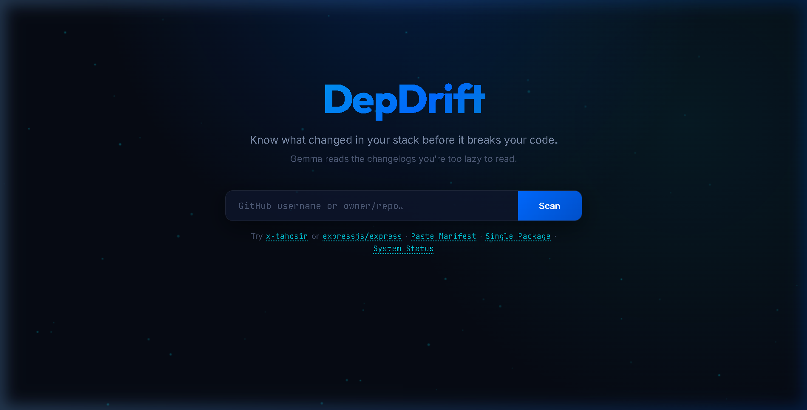
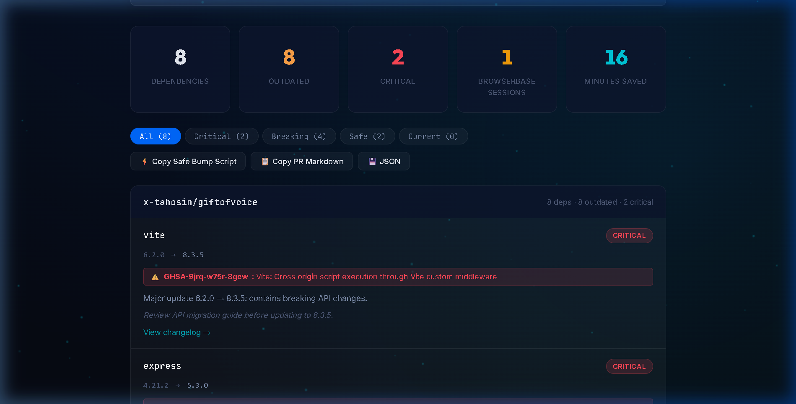
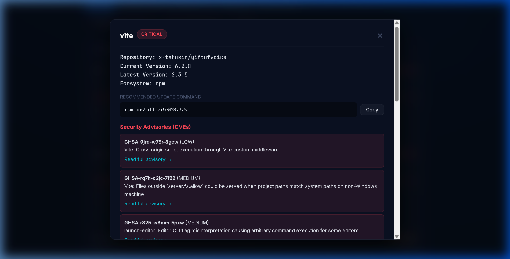

<div align="center">

# DepDrift 🔄

**The AI that reads the changelogs you're too lazy to read.**

[](LICENSE)
[](https://python.org)
[](https://fastapi.tiangolo.com)
[](https://browserbase.com)
[-0080ff.svg)](https://ai.google.dev/gemma)
[](#test-suite)

*Built for the **[Hacktoberfest Open-Source AI Challenge: Week 3 — Slow and Steady](https://dev.to/challenges/hacktoberfest-week3-2026-10-19)**.*  
*Target Category: **Best Use of Browserbase**.*

---



</div>

---

## ⚡ The Problem

Every engineering team has dependency drift they keep ignoring. Dependabot opens 20 pull requests, but nobody reads 20 release changelogs. 

Half of modern npm and PyPI libraries bury their release notes across custom documentation SPAs (VitePress, Docusaurus, Next.js sites) where traditional raw markdown APIs simply do not exist. Developers are forced to either:
1. **Blindly upgrade** and spend hours debugging broken production builds.
2. **Never upgrade** and accumulate critical unpatched CVE vulnerabilities.

### The DepDrift Solution
**DepDrift** audits your repositories in under 90 seconds. It pairs **Browserbase's headless cloud browser** with **Google's Gemma 4 open-weights model** and the **GitHub Advisory Database** to give you an authoritative risk triage:

| Risk Level | Meaning | Recommended Action |
| :--- | :--- | :--- |
| 🔴 **CRITICAL** | Active CVE security vulnerability detected upstream | Update immediately; run regression tests |
| 🟡 **BREAKING** | Major API signature change or removed exports | Review migration notes before bumping |
| 🟢 **SAFE** | Bug fixes, performance improvements, internal optimizations | Safe to batch upgrade |
| ⚪ **CURRENT** | Package matches or pins to latest upstream release | No action needed |

---

## 📸 Interactive Dashboard & Results



### Key Features
- 🌐 **Browserbase Headless Cloud Browser:** When GitHub Releases are sparse or missing, DepDrift connects over Chrome DevTools Protocol (`connect_over_cdp`) to Browserbase cloud browsers, rendering dynamic documentation sites and extracting clean changelog text.
- 🛡️ **Zero-False-Positive CVE Matching:** Queries the GitHub Advisory Database and validates `vulnerable_version_range` using `packaging.specifiers.SpecifierSet` against the active package version.
- 🧠 **Gemma 4 Structured Analysis:** The open-weights model analyzes the changelog diff and emits a deterministic JSON payload with a concise summary and actionable developer advice.
- ⚡ **1-Click Batch Remediation:** Instantly copy a combined safe upgrade bash script (`npm install ... && ...`) or export a clean GitHub PR markdown table.
- 📁 **Direct Manifest Auditor & Single Package Inspector:** Audit local `package.json` or `requirements.txt` manifests directly without connecting GitHub, or inspect any npm/PyPI package on demand.
- 💾 **SQLite Audit History:** All scans are persisted to local SQLite storage (`data/depdrift.db`) with timestamped metric records.

---

## 🔍 Deep CVE & Vulnerability Inspector

Clicking on any dependency card opens a deep inspection drawer showing the exact CVE security advisories, vulnerability severities, official links, and copy-paste update commands:

<div align="center">



</div>

---

## 🏗️ Architecture

```
User (Browser)
      │
      ▼
FastAPI Backend (SSE Event Stream)
      │
      ├── GitHub REST API (Authenticated 5,000 req/hr)
      │     └── Discovers repos & parses package.json / requirements.txt
      │
      ├── npm & PyPI Registry APIs
      │     └── Resolves latest published semver versions
      │
      ├── GitHub Security Advisory Database (GHSA / CVE)
      │     └── Validates vulnerable_version_range via SpecifierSet
      │
      ├── Browserbase (Cloud Headless Chromium via CDP)
      │     └── Navigates dynamic SPAs, waits for hydration, and extracts release notes
      │
      └── Gemma 4 (Open-Weights Model)
            └── Analyzes changelog diffs: { summary, risk, action }
```

---

## 🛠️ Technology Stack

| Layer | Component | Description |
| :--- | :--- | :--- |
| **Cloud Browser** | **[Browserbase](https://browserbase.com)** | Serverless Chromium browser infrastructure for dynamic client-rendered documentation extraction |
| **AI Model** | **[Gemma 4](https://ai.google.dev/gemma)** (`gemma-4-26b-a4b-it`) | High-reasoning open-weights model for changelog classification and risk triage |
| **Backend** | **Python 3.11+ / FastAPI** | High-concurrency async engine streaming real-time Server-Sent Events (SSE) |
| **Security** | **GitHub Advisory API** | Authenticated CVE & GHSA lookup engine |
| **Database** | **SQLite 3** | Local persistence for historical audit tracking |
| **Frontend** | **Vanilla HTML5, CSS3, ES6 JavaScript** | Ambient starfield particle canvas, dark ocean glassmorphic aesthetic |

---

## 🚀 Quick Start

### 1. Clone the Repository
```bash
git clone https://github.com/x-tahosin/depdrift.git
cd depdrift
```

### 2. Set Up Virtual Environment
```bash
python -m venv .venv

# On Linux/macOS:
source .venv/bin/activate

# On Windows:
.venv\Scripts\activate
```

### 3. Install Dependencies
```bash
pip install -r requirements.txt
playwright install chromium
```

### 4. Configure Environment
Create a `.env` file in the project root:
```env
PORT=8000
GITHUB_TOKEN=your_github_personal_access_token
BROWSERBASE_API_KEY=your_browserbase_api_key
BROWSERBASE_PROJECT_ID=your_browserbase_project_id
GEMMA_API_KEY=your_google_ai_studio_api_key
GEMMA_MODEL=gemma-4-26b-a4b-it
```

### 5. Launch the Server
```bash
python -m uvicorn app.main:app --reload --port 8000
```
Open **[http://localhost:8000](http://localhost:8000)** in your browser.

---

## 🧪 Test Suite

DepDrift includes a full automated test suite covering API endpoints, manifest parsers, semver comparisons, and SQLite audit lifecycles:

```bash
python -m pytest -v
```

```text
============================= test session starts =============================
platform win32 -- Python 3.12.10, pytest-9.0.3, pluggy-1.6.0
collected 12 items

tests/test_api.py::test_health_endpoint PASSED                           [  8%]
tests/test_api.py::test_diagnostics_endpoint PASSED                      [ 16%]
tests/test_api.py::test_history_endpoint PASSED                          [ 25%]
tests/test_api.py::test_manifest_scan_invalid_syntax PASSED              [ 33%]
tests/test_db.py::test_audit_lifecycle PASSED                            [ 41%]
tests/test_parsers.py::test_parse_package_json_dependencies PASSED       [ 50%]
tests/test_parsers.py::test_parse_package_json_clean_version PASSED      [ 58%]
tests/test_parsers.py::test_parse_package_json_invalid PASSED            [ 66%]
tests/test_parsers.py::test_parse_requirements_txt_simple PASSED         [ 75%]
tests/test_parsers.py::test_parse_requirements_txt_empty PASSED          [ 83%]
tests/test_registry.py::test_is_outdated_comparison PASSED               [ 91%]
tests/test_registry.py::test_is_outdated_prerelease PASSED               [100%]

============================= 12 passed in 5.84s ==============================
```

---

## 📄 License

Distributed under the **MIT License**. See [LICENSE](LICENSE) for more information.

Developed for **Hacktoberfest Open-Source AI Challenge Week 3** by [@x-tahosin](https://github.com/x-tahosin).
